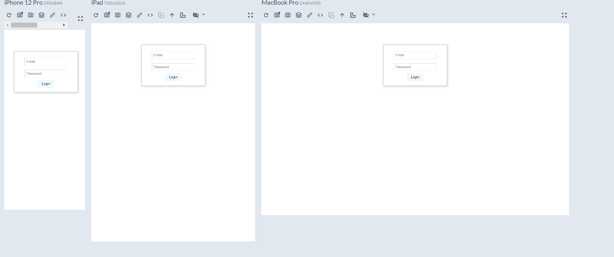
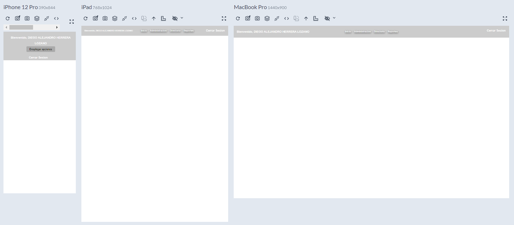
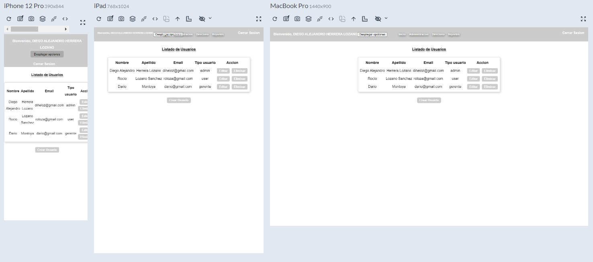
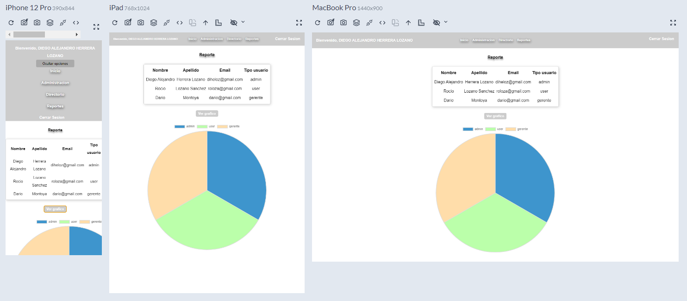

# Sistema de Administración con Roles y Autenticación JWT

## Sitio web desplegado
https://diheloz.freehosting.dev/

## Credenciales 
- Email: admin@gmail.com
- password: admin             

## Descripción
Aplicación web fullstack que permite la gestión de usuarios y directorio telefónico, con control de acceso por roles, autenticación mediante JWT y consumo de API REST sin recarga de página.

## Tecnologías
- PHP
- MySQL
- JavaScript
- HTML
- CSS
- JWT

## Características
- Login
- Roles
- CRUD
- API REST

## Instalación
1. Clonar repositorio
2. Importar database.sql
3. composer install
4. Ejecutar servidor

## Capturas

### Login

### Dashboard

### Roles

### Reportes

